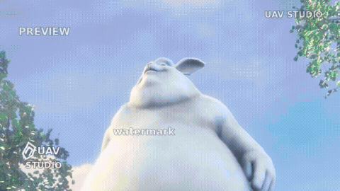
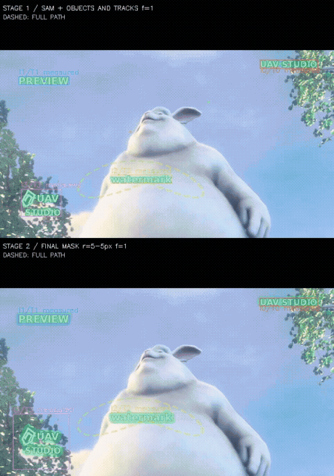
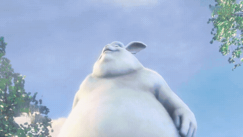

# UAV · Unmark Any Video

Remove text watermarks and logos from videos automatically. No boxes or masks to draw.

UAV combines **SAM3 detection, SIFT tracking and shared watermark templates, and ProPainter video inpainting**. It handles static corner marks, moving text, rotating logos, and watermarks that appear intermittently.

Built for fast GPU inference and consistent masks across frames: shared templates reduce detection flicker, trajectory checks reconnect missed observations, and overlapping repair windows improve temporal continuity.

## Demo

One clip with four watermark behaviors. Processed with `high quality`. The animations below play directly in this README; full-resolution MP4 files are included in `docs/demo/`.

### Input

### Debug

Top: detection and tracking. Bottom: final masks and corrected tracks.

### Result

12 seconds · 640×360 · 24 fps. Background: *Big Buck Bunny*, © 2008 Blender Foundation, CC BY 3.0. Watermarks and logo are synthetic. [Source and reproduction](docs/demo/README.md).

## Try it

Requires Linux, an NVIDIA GPU, Docker, and NVIDIA Container Toolkit. Developed on an RTX 2080 Ti with 11 GB VRAM; memory usage depends on resolution and mask area.

### 1. Build

	git clone https://github.com/What-a-stupid-username/uav.git
	cd uav
	docker build -t uav:local .

### 2. Download weights

| File | Source |
| --- | --- |
| `models/sam3/sam3.pt` | [Meta SAM3](https://huggingface.co/facebook/sam3); access approval required |
| `models/propainter/ProPainter.pth` | [ProPainter release](https://github.com/sczhou/ProPainter/releases/tag/v0.1.0) |
| `models/propainter/raft-things.pth` | Same release |
| `models/propainter/recurrent_flow_completion.pth` | Same release |

### 3. Run the included demo

	./docker/run.sh "$(realpath docs/demo/input.mp4)" ./demo-output --high-quality --debug

Output: `demo-output/clip-01/repaired.mp4`. Open `demo-output/clip-01/index.html` for masks, tracks, and template views.

For your own video:

	./docker/run.sh /absolute/path/input.mp4 ./output

Use a fresh output directory for each run. The first run builds TensorRT engines and compiles CUDA kernels; later runs reuse the caches.

## How it works

1. **Detect and track.** SAM3 discovers watermarks every eight frames. SIFT estimates position, rotation, and scale. Instances of the same watermark share a template.
2. **Build masks.** A second pass associates fragments and repairs trajectory gaps. Up to eight original-image views refine each shared template into a mask.
3. **Restore the background.** ProPainter aligns neighboring frames with optical flow and fills the masked regions. Long videos are processed in overlapping segments.

## Speed

The included demo takes **about 50 seconds** on an **RTX 2080 Ti (11 GB)**: 12 seconds of video, 288 frames, 640×360, high-quality mode, including model initialization, mask generation, debug output, inpainting, and video encoding. That is **5.7 processed frames/s**. Existing engine and compiler caches were reused; first-time compilation takes longer.

UAV uses TensorRT FP16, CUDA SIFT, GPU descriptor matching, CUDA Graphs, cached reference features, and overlapping CPU/GPU work. Runtime depends heavily on resolution, watermark count, and mask area. This is a single demo measurement, not a cross-project benchmark.

## Quality options

| Mode | Inpainting resolution | Window overlap | RAFT iterations |
| --- | --- | --- | --- |
| Default | 70% of input width and height | 3 frames | 4 |
| `--high-quality` | Original resolution | 5 frames | 8 |

	./docker/run.sh /absolute/input.mp4 ./output-hq --high-quality
	./docker/run.sh /absolute/input.mp4 ./output-debug --debug
	./docker/run.sh /absolute/input.mp4 ./output-masks --no-repair

`--debug` writes the mask/trajectory review page. `--no-repair` exports masks without inpainting.

## Batch processing and Python

	./docker/batch.sh ./batch-output /absolute/a.mp4 /absolute/b.mp4

In the UAV Python/CUDA environment:

	from uav import UAVConfig, run

	report = run("input.mp4", "output", UAVConfig.high_quality())

Batch jobs reuse model weights. See the [usage guide](docs/usage.md) for the persistent worker, parameters, and report format.

## Limitations

- Output defaults to 24 fps at the original frame size. **Audio is not preserved.**
- Long videos use 15-second segments with one second of overlap; short tails extend the preceding segment.
- Faint or feature-poor marks can be missed. Large occlusions and complex backgrounds may leave artifacts.
- A startup check skips videos whose detected watermark boxes cover more than 15% of the frame. Thresholds are configurable.

## License

[Non-commercial use](LICENSE). SAM3, ProPainter, and other dependencies retain their own licenses; see [third-party notices](THIRD_PARTY_NOTICES.md).
