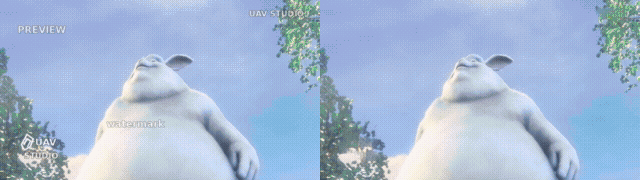

# UAV · Unmark Any Video

自动去除视频中的文字水印和 logo，无需手动画框或提供 mask。

支持静止角标、移动、旋转和间歇出现的水印。使用 **SAM3 检测 + SIFT 跟踪与共享模板 + ProPainter 修复**：先找到水印并补齐逐帧 mask，再利用相邻帧恢复背景。

## Demo

同一段视频包含静止角标、移动文字、闪现文字和旋转 logo。左：输入；右：修复结果。

[原视频](docs/demo/input.mp4) · [Debug：检测、轨迹与 mask](docs/demo/debug.mp4) · [修复结果](docs/demo/result.mp4)

12 秒，640×360，24 fps，使用高质量模式。背景来自 Blender 的《Big Buck Bunny》（CC BY 3.0），水印为脚本生成。素材来源和复现方法见 [Demo 说明](docs/demo/README.md)。

## 如何工作

1. **发现与跟踪**：SAM3 每 8 帧检测一次，SIFT 跟踪各个水印的位置、旋转和尺度。同一种水印的多个实例共享模板。
2. **补全 mask**：结合前后轨迹关联残片、补查缺口，对每个共享模板选最多 8 份原图精修并融合。
3. **修复视频**：ProPainter 通过光流对齐邻帧背景，填补 mask 区域。长视频自动分段，段间重叠融合。

## 快速开始

需要 Linux、NVIDIA GPU、Docker 和 NVIDIA Container Toolkit。开发环境为 RTX 2080 Ti（11 GB）；显存需求随分辨率和水印面积变化。

### 1. 获取代码并构建环境

	git clone https://github.com/What-a-stupid-username/uav.git
	cd uav
	docker build -t uav:local .

### 2. 准备权重

权重需自行下载，放到以下位置：

| 文件 | 下载来源 |
| --- | --- |
| models/sam3/sam3.pt | [Meta SAM3](https://huggingface.co/facebook/sam3)，需申请访问 |
| models/propainter/ProPainter.pth | [ProPainter Releases](https://github.com/sczhou/ProPainter/releases/tag/v0.1.0) |
| models/propainter/raft-things.pth | 同上 |
| models/propainter/recurrent_flow_completion.pth | 同上 |

### 3. 运行

	./docker/run.sh /absolute/path/input.mp4 ./output

结果位于 **output/clip-01/repaired.mp4**，运行报告为 output/report.json。每次使用新的输出目录。首次运行会构建 TensorRT 引擎和编译 CUDA 算子，后续复用缓存。

## 质量与调试

| 模式 | 修复分辨率 | 时间窗口重叠 | RAFT 迭代 |
| --- | --- | --- | --- |
| 默认 | 原宽高的 70% | 3 帧 | 4 次 |
| --high-quality | 原分辨率 | 5 帧 | 8 次 |

	# 高质量修复
	./docker/run.sh /absolute/path/input.mp4 ./output-hq --high-quality

	# 生成 mask、轨迹与模板审核页面
	./docker/run.sh /absolute/path/input.mp4 ./output-debug --debug

	# 只生成 mask
	./docker/run.sh /absolute/path/input.mp4 ./output-masks --no-repair

Debug 页面位于 output-debug/clip-01/index.html，包含 Stage1/Stage2 对照和模板图片。较长视频的入口为 output-debug/index.html。

## 批处理与 Python

	./docker/batch.sh ./batch-output /absolute/a.mp4 /absolute/b.mp4

在配套 Python/CUDA 环境中：

	from uav import UAVConfig, run

	report = run("input.mp4", "output", UAVConfig.high_quality())

批处理会复用模型，单个视频失败不影响后续视频。常驻 worker、参数和报告格式见 [使用说明](docs/usage.md)。

## 当前限制

- 默认输出 24 fps，保留画面尺寸，**暂不保留音频**。
- 默认按 15 秒分段，相邻段重叠 1 秒；短尾段会并入上一段。
- 淡水印、复杂背景和缺少特征的水印可能漏检或误检；大面积遮挡无法保证恢复原始细节。
- 默认跳过检测框覆盖超过画面 15% 的视频，可调整面积阈值，见使用说明。

## 许可

[非商业使用](LICENSE)。SAM3、ProPainter 等组件保留各自许可，详见 [第三方声明](THIRD_PARTY_NOTICES.md)。
